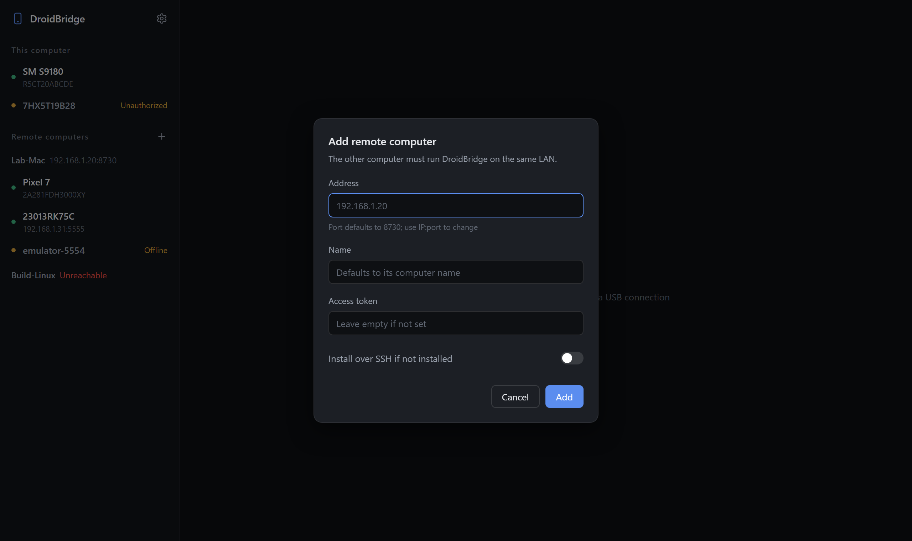

# DroidBridge

[简体中文](README.zh-CN.md)

See and control Android devices from your computer — not only the ones plugged into it, but also those plugged into other computers on your LAN.


- **Mirror & control** — low-latency hardware-encoded mirroring powered by [scrcpy](https://github.com/Genymobile/scrcpy); touch, multi-touch, scroll, keyboard, clipboard, screenshots
- **Many computers, one view** — run DroidBridge on every computer with phones attached, add them in one place, and use all devices from there
- **One-click SSH deployment** — when adding a macOS / Linux computer, DroidBridge can install itself over SSH and register a login service
- **Device logs** — live logcat next to the screen, filterable by level, text and app
- **Install APKs / send files** — drop them onto a device screen
- **Desktop app or browser** — native desktop app for Windows, macOS and Linux; phones and other computers can also use a browser

| Device logs | Add a remote computer | Phone browser |
|---|---|---|
|  |  |  |

> Screenshots use mock data; the phone screens are drawn placeholders (generated by `tools/demo/shots.ps1`).

## How it works

```
 Desktop app / browser
   │  HTTP + WebSocket (talks only to the node it opened)
   ▼
 DroidBridge node A ──USB/adb──▶ Android devices 1, 2…
   │  proxies device lists, video, logs and files
   ▼
 DroidBridge node B (another computer on the LAN) ──USB/adb──▶ Android devices 3, 4…
```

- A node pushes scrcpy-server to the device through `adb`. The device encodes its screen to H.264 with MediaCodec; the stream comes back over `adb forward`, is relayed over WebSocket, and is decoded in hardware with WebCodecs.
- Touch and key events are sent back using the scrcpy control protocol.
- The UI only talks to its own node; devices on remote computers are proxied by that node, so remote computers only need their HTTP port reachable.

## Download

Get the latest build from [Releases](https://github.com/dmxzxy/DroidBridge/releases). Every package includes Android platform-tools (`adb`).

| Platform | Desktop app | Server only |
|---|---|---|
| Windows x64 | `DroidBridge-<ver>-windows-x64.zip` → `DroidBridge.exe` (needs WebView2, preinstalled on Windows 10/11) | same zip → `droidbridge-server.exe` |
| macOS (Apple Silicon & Intel) | `DroidBridge-<ver>-macos-universal.zip` → `DroidBridge.app` | `droidbridge-server-<ver>-macos-universal.tar.gz` |
| Linux x86_64 | `droidbridge-desktop-<ver>-linux-x86_64.tar.gz` (needs WebKitGTK 4.1, e.g. `libwebkit2gtk-4.1-0`) | `droidbridge-server-<ver>-linux-x86_64.tar.gz` |

The desktop app also runs the server, so other computers can add it. Use the server-only build on computers that just host phones.

> **macOS:** the app is not notarized. On first launch, right-click it and choose **Open**, or run `xattr -cr DroidBridge.app`.
>
> **Linux:** to use USB devices without root, install your distribution's Android udev rules (e.g. `android-sdk-platform-tools-common`).

## Usage

1. On the phone, enable **Developer options → USB debugging**, connect it, and tap **Allow**. Xiaomi / Redmi devices also need **USB debugging (Security settings)**, otherwise touches and typing don't work.
2. Start DroidBridge and click a device in the sidebar.
3. To add another computer, click **+** next to **Remote computers** and enter its IP (default port 8730).
   - Windows: run DroidBridge on that computer.
   - macOS / Linux without DroidBridge: turn on **Install over SSH if not installed**. DroidBridge logs in with the keys in your `~/.ssh`, uploads the source and builds it there (installing Rust with rustup for the current user if needed), finds or installs `adb` (Homebrew), and registers a login service (launchd / `systemd --user`).
4. If the firewall asks, allow DroidBridge on private networks; otherwise other computers cannot connect.

### Controls

| Input | Action |
|---|---|
| Click / drag, touch (multi-touch) | Tap / swipe |
| Right click, Esc | Back |
| Middle click | Home |
| Wheel | Scroll |
| Type with the screen focused | Text; Enter, Backspace and arrows work |
| Ctrl+V | Paste the computer clipboard to the device |
| Side toolbar | Power, volume, rotate, screenshot, type text (any language), logs; **…** for notifications, screen off, install APK, reconnect |
| Drop files on the screen | Install APKs, copy other files to `/sdcard/Download` |

### Device logs

Click **Logs** in the side toolbar. The panel docks to the right when there is room, otherwise below.

- Filter by level and text (space-separated words must all match; `-word` excludes)
- Enter a package name, or click ⊙ to pick the foreground app, to show only that app (tracked across restarts)
- Pause, clear, save to a text file

### Browser access

WebCodecs only works in a secure context (`https://` or `localhost`):

- On the same computer: `http://localhost:8730`
- From other devices: `https://<computer-ip>:8731` (self-signed certificate generated on first start; accept the warning once)

### Language

The UI follows the system language (Chinese or English). Change it in **Settings → Language**, or start with `--lang en` / `--lang zh`.

## Security

DroidBridge gives full control over the attached devices and requires **no authentication by default**. Only use it on trusted networks:

- Set an access token with `--token <token>` (required by the UI and by other nodes), or use `--bind 127.0.0.1` to allow local access only.
- Do not expose the ports to the internet.
- Tokens of remote computers are stored in plain text in `peers.json` in the data directory.

## Command line

```
--port <port>         HTTP port (default 8730)
--https-port <port>   HTTPS port (default 8731, 0 to disable)
--bind <addr>         Listen address (default 0.0.0.0)
--token <token>       Access token (or the DROIDBRIDGE_TOKEN environment variable)
--name <name>         Display name (default: computer name)
--adb <path>          Path to adb (default: bundled platform-tools, ANDROID_HOME, common locations, PATH)
--data <dir>          Data directory (see below)
--lang <zh|en>        UI and message language (default: system; or DROIDBRIDGE_LANG)
```

Default data directory (remote computer list, certificate, logs): next to the program on Windows (`data\`), `~/Library/Application Support/DroidBridge` on macOS, `~/.local/share/droidbridge` on Linux.

## Building from source

Requires Rust 1.85+. On Linux, the desktop app also needs `libwebkit2gtk-4.1-dev` and `libgtk-3-dev`.

```sh
cargo run                                               # server
cargo run --features desktop --bin droidbridge-desktop  # desktop app
cargo test
```

Packaging:

```sh
powershell -File build.ps1 -Version 0.2.0   # Windows (downloads platform-tools)
sh tools/package-mac.sh 0.2.0               # macOS
sh tools/package-linux.sh 0.2.0             # Linux
```

Releases are built by GitHub Actions: pushing a `v*` tag builds all platforms and creates a draft release.

### Layout

```
src/lib.rs          HTTP server, routes, token check, remote computers, uploads
src/main.rs         server entry point
src/bin/desktop.rs  desktop app (tao + wry)
src/adb.rs          adb invocation and device list
src/scrcpy.rs       mirroring session: start scrcpy-server, relay video and control
src/control.rs      JSON control messages → scrcpy v5 control protocol
src/logcat.rs       logcat stream and app filter
src/peers.rs        remote computer storage, HTTP / WebSocket proxy
src/remote.rs       install over SSH to macOS / Linux
src/i18n.rs         Chinese / English messages
src/icon.rs         generated app icon
web/index.html      UI (single file, embedded at build time)
third_party/        scrcpy-server v5.0.1 (see third_party/README.md)
tools/              packaging, dependency download, screenshots
```

### API

| Endpoint | Description |
|---|---|
| `GET /api/info` | Node info |
| `GET /api/devices?peer=` | Devices (`peer` = remote computer id; omit for this computer) |
| `GET/POST /api/peers`, `PUT/DELETE /api/peers/{id}` | Remote computers |
| `POST /api/install`, `GET /api/install/{job}` | Install over SSH |
| `POST /api/push?serial=&name=&peer=` | Upload a file (APKs are installed, others copied to Download) |
| `WS /ws/stream?serial=&peer=&max_size=&bit_rate=&max_fps=` | Video and control |
| `WS /ws/logcat?serial=&peer=` | Device logs |

Binary messages on `/ws/stream` are `[flags u8][pts u64 BE][H.264 Annex-B]` (flags bit0 = config packet, bit1 = key frame). Control messages are JSON, e.g. `{"t":"touch","action":0,"id":-2,"x":100,"y":200,"w":720,"h":1600}`; see `src/control.rs`.

## Roadmap

- Automatic discovery of nodes on the LAN
- Wireless adb (pairing / connect)
- Audio forwarding, screen recording
- Synchronized control of multiple devices

## Acknowledgements

- [scrcpy](https://github.com/Genymobile/scrcpy) (Apache-2.0) provides the on-device mirroring and control server
- [tao](https://github.com/tauri-apps/tao) / [wry](https://github.com/tauri-apps/wry), [axum](https://github.com/tokio-rs/axum), [tokio](https://tokio.rs)

## License

DroidBridge is released under the [MIT](LICENSE) license. The bundled scrcpy-server is Apache-2.0; see [third_party/README.md](third_party/README.md).
