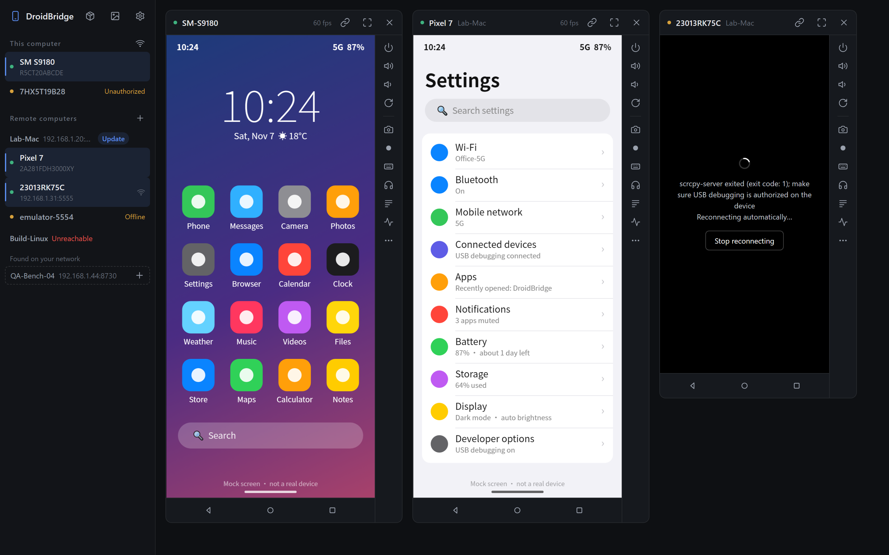
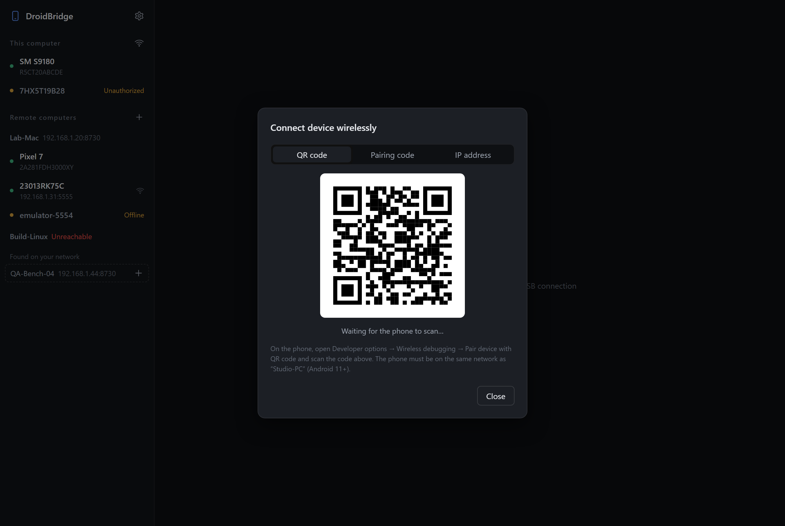
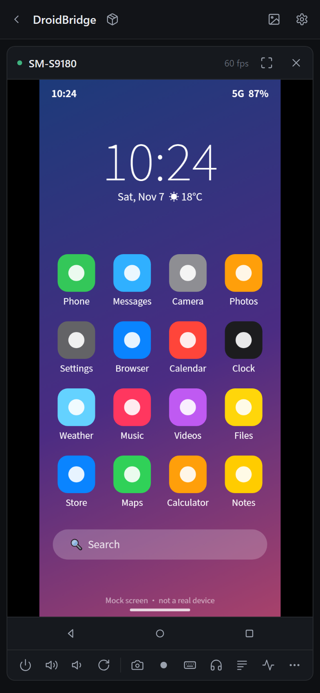
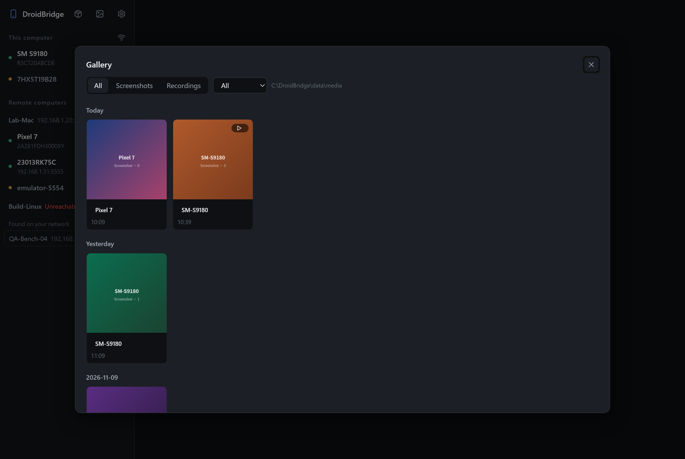
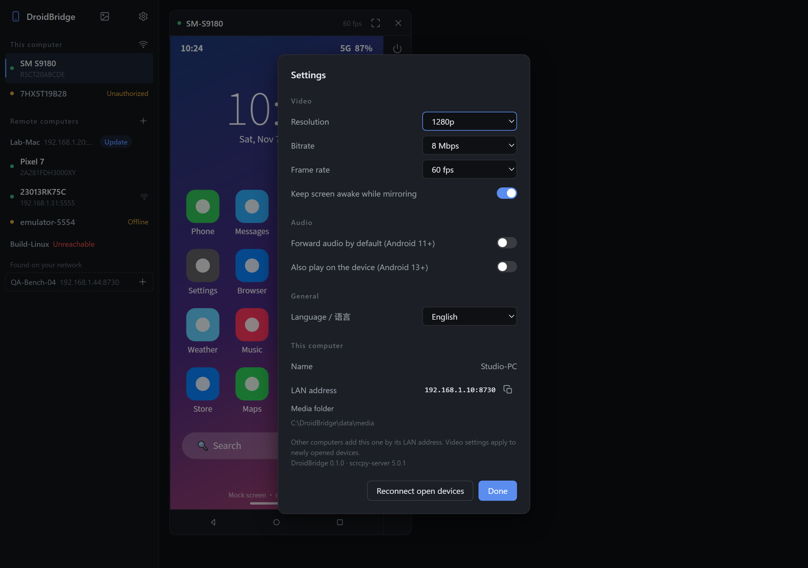
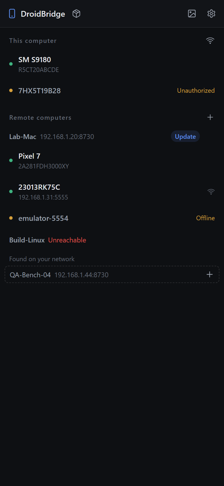
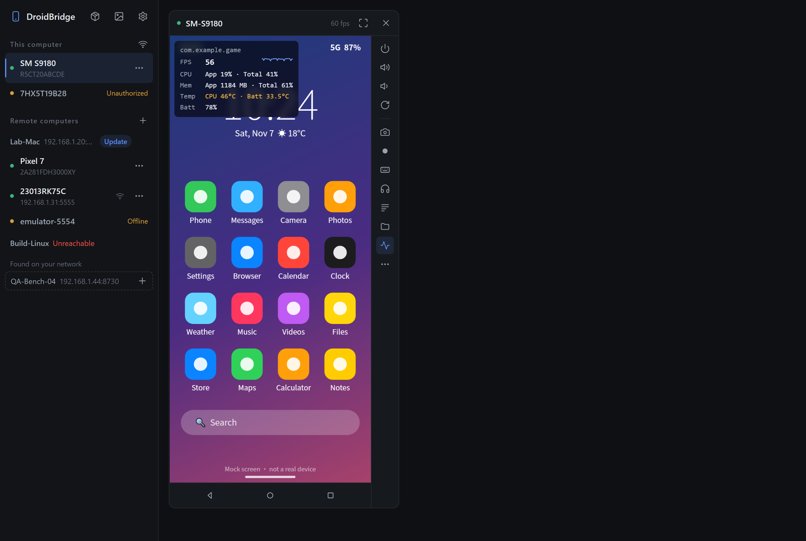
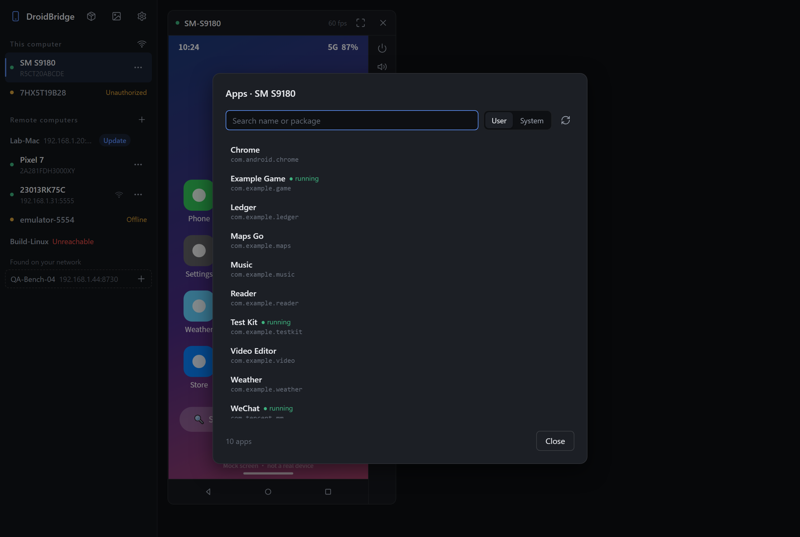
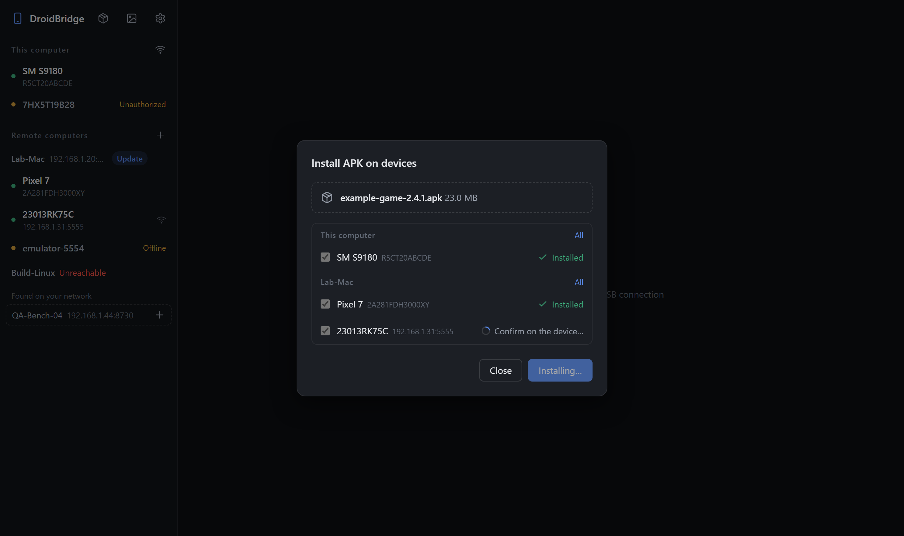

# DroidBridge

[简体中文](README.zh-CN.md)

See and control Android devices from your computer — not only the ones plugged into it, but also those plugged into other computers on your LAN.



- **Mirror & control** — low-latency hardware-encoded mirroring powered by [scrcpy](https://github.com/Genymobile/scrcpy); touch, multi-touch, scroll, keyboard, clipboard, screenshots, screen recording
- **Many computers, one view** — run DroidBridge on every computer with phones attached; computers on the same LAN are discovered automatically and added with one click
- **Wireless adb** — pair with a QR code or pairing code (Android 11+), connect by IP, or switch a USB device to Wi-Fi
- **Auto-reconnect** — after a cable is re-plugged, the device reboots or Wi-Fi drops, mirroring resumes by itself (and falls back to USB / Wi-Fi if the same phone is reachable another way)
- **Audio forwarding** — hear the device on your computer (Android 11+)
- **One-click SSH deployment** — when adding a macOS / Linux computer, DroidBridge can install itself over SSH and register a login service
- **Device logs** — live logcat next to the screen, filterable by level, text and app
- **Performance overlay** — FPS, CPU, memory, temperature and battery of the foreground app, on top of the screen
- **App manager** — list installed apps; launch, force stop, clear data, uninstall
- **Batch install & group control** — install one APK on many devices at once; mirror taps and keys on several devices
- **AI agents (MCP)** — let Claude Code, Cursor and other MCP clients read the screen and operate any device; you watch every action live and can pause the AI
- **Install APKs / send files** — drop them onto a device screen
- **Gallery** — screenshots and recordings are saved on the node and browsed in a gallery (filter by type / device, preview, download, reveal in file manager)
- **Desktop app or browser** — native desktop app for Windows, macOS and Linux; phones and other computers can also use a browser

| Device logs | Wireless pairing | Phone browser |
|---|---|---|
|  |  |  |
|  |  |  |
|  |  |  |

> Screenshots use mock data; the phone screens are drawn placeholders (generated by `tools/demo/shots.ps1`).

## How it works

```
 Desktop app / browser
   │  HTTP + WebSocket (talks only to the node it opened)
   ▼
 DroidBridge node A ──USB/adb──▶ Android devices 1, 2…
   │  proxies device lists, video, logs and files
   ▼
 DroidBridge node B (another computer on the LAN) ──USB/adb──▶ Android devices 3, 4…
```

- A node pushes scrcpy-server to the device through `adb`. The device encodes its screen to H.264 with MediaCodec; the stream comes back over `adb forward`, is relayed over WebSocket, and is decoded in hardware with WebCodecs.
- Touch and key events are sent back using the scrcpy control protocol.
- The UI only talks to its own node; devices on remote computers are proxied by that node, so remote computers only need their HTTP port reachable.

## Download

Get the latest build from [Releases](https://github.com/dmxzxy/DroidBridge/releases). Every package includes Android platform-tools (`adb`).

| Platform | Desktop app | Server only |
|---|---|---|
| Windows x64 | `DroidBridge-<ver>-windows-x64.zip` → `DroidBridge.exe` (needs WebView2, preinstalled on Windows 10/11) | same zip → `droidbridge-server.exe` |
| macOS (Apple Silicon & Intel) | `DroidBridge-<ver>-macos-universal.zip` → `DroidBridge.app` | `droidbridge-server-<ver>-macos-universal.tar.gz` |
| Linux x86_64 | `droidbridge-desktop-<ver>-linux-x86_64.tar.gz` (needs WebKitGTK 4.1, e.g. `libwebkit2gtk-4.1-0`) | `droidbridge-server-<ver>-linux-x86_64.tar.gz` |

The desktop app also runs the server, so other computers can add it. Use the server-only build on computers that just host phones.

> **macOS:** the app is not notarized. On first launch, right-click it and choose **Open**, or run `xattr -cr DroidBridge.app`.
>
> **Linux:** to use USB devices without root, install your distribution's Android udev rules (e.g. `android-sdk-platform-tools-common`).

## Usage

1. On the phone, enable **Developer options → USB debugging**, connect it, and tap **Allow**. Xiaomi / Redmi devices also need **USB debugging (Security settings)**, otherwise touches and typing don't work.
2. Start DroidBridge and click a device in the sidebar.
3. Other computers running DroidBridge on the same LAN appear under **Found on your network**; click **+** to add one. You can also click **+** next to **Remote computers** and enter an IP (default port 8730).
   - Windows: run DroidBridge on that computer.
   - macOS / Linux without DroidBridge: choose the **Install over SSH** tab. Sign in with your SSH keys (`~/.ssh`, ssh-agent, `~/.ssh/config`), a password, or a specific key file. With a password, **Remember** adds this computer's public key so later reinstalls need no password; passwords are never stored. DroidBridge installs the prebuilt server of the same version from GitHub Releases (the remote computer downloads it; if it cannot reach GitHub, this computer downloads and uploads it; the SHA-256 checksum is verified). If neither works, or for development builds, it uploads the source and builds it there (installing Rust with rustup if needed). It then uses an existing `adb` or the bundled platform-tools, and registers a login service (launchd / `systemd --user`) that restarts automatically.
4. If the firewall asks, allow DroidBridge on private networks; otherwise other computers cannot connect.

### Controls

| Input | Action |
|---|---|
| Click / drag, touch (multi-touch) | Tap / swipe |
| Right click, Esc | Back |
| Middle click | Home |
| Wheel | Scroll |
| Type with the screen focused | Text; Enter, Backspace and arrows work |
| Ctrl+V | Paste the computer clipboard to the device |
| Side toolbar | Power, volume, rotate, screenshot, record, type text (any language), logs; **…** for notifications, screen off, install APK, reconnect |
| Drop files on the screen | Install APKs, copy other files to `/sdcard/Download` |

### Wireless devices

Click the Wi-Fi icon next to **This computer** (or **Connect device wirelessly…** in a remote computer’s **…** menu). The phone must be on the same network as that computer.

- **QR code** (Android 11+): on the phone, open Developer options → Wireless debugging → Pair device with QR code, and scan
- **Pairing code** (Android 11+): enter the pairing address, port and code shown on the phone
- **IP address**: for paired devices or devices in `adb tcpip` mode
- For a USB device, **…** → **Switch to wireless** runs `adb tcpip 5555` and connects; then you can unplug it

Wireless addresses are remembered and reconnected in the background; paired devices advertised over mDNS are reconnected too.

### Audio

Click the headphones icon in the side toolbar, or turn on **Settings → Audio → Forward audio by default**. Requires Android 11+ (on Android 11 the device must be unlocked when mirroring starts). Audio is Opus-encoded, or raw PCM when the browser lacks an Opus decoder. **Also play on the device** keeps sound on the phone too (Android 13+).

### Screenshots, recording and gallery

Click the **camera** icon to capture the current screen, or the **record** icon (red dot) to start / stop a screen recording. Screenshots are saved as PNG, recordings as WebM / MP4 (with audio when audio forwarding is on). Files are stored on the node you are connected to, in the **media directory** (default `<data>/media`, changeable in Settings → Save screenshots to, or with `--media-dir`). If the app closes or the page is reloaded mid-recording, the partial file is recovered automatically (a recording left idle for 2 minutes is finalised as a playable file).

Click the **gallery** icon next to the sidebar gear to browse everything: filter by type or device, click a thumbnail to preview (arrow keys / buttons to step, Esc to close), download, reveal in the file manager, or delete.

### Device logs

Click **Logs** in the side toolbar. The panel docks to the right when there is room, otherwise below.

- Filter by level and text (space-separated words must all match; `-word` excludes)
- Enter a package name, or click ⊙ to pick the foreground app, to show only that app (tracked across restarts)
- Pause, clear, save to a text file

### Performance overlay

Click **Performance** (pulse icon) in the side toolbar. The overlay refreshes every second:

- **FPS** of the foreground app, counted from SurfaceFlinger frame times (works for games and SurfaceView; falls back to `dumpsys gfxinfo`), with a short history line
- **CPU** of the app and of the whole device (`/proc/stat`, `/proc/<pid>/stat`)
- **Memory** of the app (PSS from `dumpsys meminfo`) and of the device
- **Temperature** (CPU from `dumpsys thermalservice`, battery) and **battery level**

Sampling runs one short adb command per second; turn the overlay off when you don't need it.

### Apps

**More (⋯) → Apps…** lists installed apps with their names (read on the device by scrcpy-server), split into user and system apps, with search. Running apps are marked. Launch an app directly, or use ⋯ for force stop, clear data and uninstall (both ask for confirmation).

Some systems block clearing data over adb: on OPPO / OnePlus / realme turn on "Disable permission monitoring" in Developer options; on Xiaomi turn on "USB debugging (Security settings)".

### Batch install and group control

- **Install on many devices**: click the package icon at the top of the sidebar (or drop an APK onto an empty part of the window), pick the devices — on this computer and on remote computers — and install. Up to 4 devices install at a time; each row shows its result, and failed devices can be retried. Some phones (OPPO, vivo, Xiaomi…) ask for confirmation on the device; the row shows "Confirm on the device…".
- **Group control**: with two or more devices open, click the link icon in each device's title bar. Taps, swipes, scrolling, keys and typed text on any grouped device are sent to all grouped devices; coordinates are scaled to each device's resolution, so devices with the same aspect ratio line up best.

### Browser access

WebCodecs only works in a secure context (`https://` or `localhost`):

- On the same computer: `http://localhost:8730`
- From other devices: `https://<computer-ip>:8731` (self-signed certificate generated on first start; accept the warning once)

### Updating remote computers

When a remote computer runs an older version than this one, an **Update** badge appears next to its name. For computers installed over SSH with keys (or a password with **Remember**), one click installs this computer's version and restarts the service; otherwise the reinstall dialog opens. Windows computers must be updated on the computer itself.

To update everything: update DroidBridge on your own computer, then click **Update** on each remote computer.

For networks without GitHub access, host the release files (the `droidbridge-server-*.tar.gz` packages and `SHA256SUMS.txt`) on an internal web server and start DroidBridge with the environment variable `DROIDBRIDGE_RELEASE_BASE=http://server/path`.

### AI agents (MCP)

DroidBridge is an [MCP](https://modelcontextprotocol.io) server at `http://127.0.0.1:8730/mcp` (Streamable HTTP; the address is also shown in Settings). Any MCP client can then see and operate every device on this computer and on connected remote computers.

```bash
# Claude Code
claude mcp add --transport http droidbridge http://127.0.0.1:8730/mcp
```

```json
// Cursor and other clients that use an mcpServers JSON file
{ "mcpServers": { "droidbridge": { "url": "http://127.0.0.1:8730/mcp" } } }
```

With `--token`, send it as `Authorization: Bearer <token>` (or append `?token=<token>` to the URL).

Tools: `list_devices`, `read_screen` (UI elements with text, ids and coordinates — cheap and precise), `screenshot`, `tap` (by element index or coordinates), `swipe`, `type_text` (any language), `press_key`, `list_apps`, `launch_app`, `stop_app`, `logcat`, `perf`, `shell` (read-only queries only), `wait`.

While an AI operates a device, its window shows a bar with the current action and marks each tap and swipe. Click **Pause** to stop the AI from changing the device (it can still read the screen) and **Resume** to continue.

Notes:
- `read_screen` uses `uiautomator`; it cannot read games, constantly animating screens or secure screens, and on tablets with split-screen apps it may read only the focused pane — the AI falls back to `screenshot`.
- `type_text` pastes through the device clipboard, so the typed text stays in the clipboard.
- Anyone who can reach the port can use these tools; see [Security](#security).

### Language

The UI follows the system language (Chinese or English). Change it in **Settings → Language**, or start with `--lang en` / `--lang zh`.

## Security

DroidBridge gives full control over the attached devices and requires **no authentication by default**. Only use it on trusted networks:

- Set an access token with `--token <token>` (required by the UI and by other nodes), or use `--bind 127.0.0.1` to allow local access only.
- Do not expose the ports to the internet.
- The MCP endpoint (`/mcp`) lets AI clients operate the devices; it uses the same token.
- LAN discovery broadcasts the computer name and HTTP port on UDP 8730. Disable it with `--no-discovery` (it is also off with `--bind 127.0.0.1`).
- Tokens of remote computers are stored in plain text in `peers.json` in the data directory.

## Command line

```
--port <port>         HTTP port (default 8730)
--https-port <port>   HTTPS port (default 8731, 0 to disable)
--bind <addr>         Listen address (default 0.0.0.0)
--token <token>       Access token (or the DROIDBRIDGE_TOKEN environment variable)
--name <name>         Display name (default: computer name)
--adb <path>          Path to adb (default: bundled platform-tools, ANDROID_HOME, common locations, PATH)
--data <dir>          Data directory (see below)
--media-dir <dir>     Where to save screenshots and recordings (default: <data>/media)
--lang <zh|en>        UI and message language (default: system; or DROIDBRIDGE_LANG)
--no-discovery        Do not take part in LAN discovery
```

Default data directory (remote computers, wireless addresses, certificate, logs): next to the program on Windows (`data\`), `~/Library/Application Support/DroidBridge` on macOS, `~/.local/share/droidbridge` on Linux.

## Building from source

Requires Rust 1.85+. On Linux, the desktop app also needs `libwebkit2gtk-4.1-dev` and `libgtk-3-dev`.

```sh
cargo run                                               # server
cargo run --features desktop --bin droidbridge-desktop  # desktop app
cargo test
```

Packaging:

```sh
powershell -File build.ps1 -Version 0.2.0   # Windows (downloads platform-tools)
sh tools/package-mac.sh 0.2.0               # macOS
sh tools/package-linux.sh 0.2.0             # Linux
```

Releases are built by GitHub Actions: pushing a `v*` tag builds all platforms and creates a draft release.

### Layout

```
src/lib.rs          HTTP server, routes, token check, remote computers, uploads
src/main.rs         server entry point
src/bin/desktop.rs  desktop app (tao + wry)
src/adb.rs          adb invocation and device list
src/scrcpy.rs       mirroring session: start scrcpy-server, relay video and control
src/control.rs      JSON control messages → scrcpy v5 control protocol
src/logcat.rs       logcat stream and app filter
src/peers.rs        remote computer storage, HTTP / WebSocket proxy
src/discovery.rs    LAN discovery (UDP broadcast)
src/wireless.rs     wireless adb: connect, pairing, QR pairing, background reconnect
src/remote.rs       install over SSH to macOS / Linux
src/i18n.rs         Chinese / English messages
src/icon.rs         generated app icon
src/agent.rs         AI tools: screenshot, UI reading, input, apps (used by the MCP server)
src/mcp.rs           MCP server (/mcp): tool list, device routing, remote forwarding
web/index.html      page markup; loads app.css and js/*.js in order
web/app.css         styles
web/js/             UI code, split by area (classic scripts sharing one global scope):
                    i18n: texts (Chinese as keys) / 多语言
                    core: helpers, icons, preferences, toasts / 基础工具、图标、偏好、提示
                    ui: menus, dialogs, clipboard / 菜单、对话框
                    api: backend calls / 后端调用
                    devices: computers, devices, sidebar / 电脑、设备、侧栏
                    peers: remote computers, wireless, settings, help / 远程电脑、无线、设置、帮助
                    viewer: mirroring, control, recording, perf overlay, group control / 投屏与控制
                    logcat: log panel / 日志面板
                    audio: sound playback / 声音
                    gallery: screenshots and recordings / 相册
third_party/        scrcpy-server v5.0.1 (see third_party/README.md)
tools/              packaging, dependency download, screenshots
```

### API

| Endpoint | Description |
|---|---|
| `GET /api/info` | Node info |
| `GET /api/devices?peer=` | Devices (`peer` = remote computer id; omit for this computer) |
| `GET/POST /api/peers`, `PUT/DELETE /api/peers/{id}` | Remote computers |
| `POST /api/install`, `GET /api/install/{job}` | Install over SSH |
| `POST /api/push?serial=&name=&peer=` | Upload a file (APKs are installed, others copied to Download) |
| `GET /api/media` | List screenshots and recordings (`items` with `name`, `kind`, `device`, `size`, `time`, `url`) |
| `GET /api/media/file/{name}` | Serve a media file (supports HTTP Range) |
| `POST /api/media/shot?device=` | Save a screenshot (PNG body) |
| `POST /api/media/rec/start?device=&ext=`, `POST /api/media/rec/{id}?seq=`, `POST /api/media/rec/{id}/finish`, `DELETE /api/media/rec/{id}` | Chunked screen-recording upload |
| `DELETE /api/media/{name}` | Delete a media file |
| `POST /api/media/reveal?name=` | Reveal a file in the OS file manager (local requests only) |
| `GET/PUT /api/settings` | Get / change `media_dir` (PUT is local-only) |
| `GET /api/discovered` | Computers found on the LAN |
| `POST /api/adb/connect`, `/api/adb/pair`, `/api/adb/disconnect`, `/api/adb/tcpip` (`?peer=`) | Wireless adb |
| `POST /api/adb/qr`, `GET/DELETE /api/adb/qr/{job}` (`?peer=`) | QR code pairing |
| `WS /ws/stream?serial=&peer=&max_size=&bit_rate=&max_fps=&audio=` | Video, audio and control |
| `WS /ws/logcat?serial=&peer=` | Device logs |
| `POST /mcp` | MCP server (JSON-RPC over Streamable HTTP) |
| `POST /api/agent/exec` `{"tool","args"}`, `POST /api/agent/pause?peer=` `{"serial","paused"}` | Run an AI tool on this node; pause / resume AI control of a device |
| `GET /app.css`, `GET /js/{file}` | UI styles and scripts (embedded at build time) |
| `WS /ws/perf?serial=&peer=` | Performance data, one JSON message per second |
| `POST /api/apps?peer=` `{"serial"}` | Installed apps (`pkg`, `name`, `system`, `running`) |
| `POST /api/apps/action?peer=` `{"serial","pkg","action"}` | `launch` / `stop` / `clear` / `uninstall` |

Binary messages on `/ws/stream` are `[flags u8][pts u64 BE][H.264 Annex-B]` (flags bit0 = config packet, bit1 = key frame, bit2 = audio packet). Control messages are JSON, e.g. `{"t":"touch","action":0,"id":-2,"x":100,"y":200,"w":720,"h":1600}`; see `src/control.rs`.

## Roadmap

- Crash / ANR capture
- AI: record actions as replayable scripts, wait for elements, run on many devices in parallel
- Performance recording and export
- iOS devices (via WebDriverAgent)

## Acknowledgements

- [scrcpy](https://github.com/Genymobile/scrcpy) (Apache-2.0) provides the on-device mirroring and control server
- [tao](https://github.com/tauri-apps/tao) / [wry](https://github.com/tauri-apps/wry), [axum](https://github.com/tokio-rs/axum), [tokio](https://tokio.rs)

## License

DroidBridge is released under the [MIT](LICENSE) license. The bundled scrcpy-server is Apache-2.0; see [third_party/README.md](third_party/README.md).
