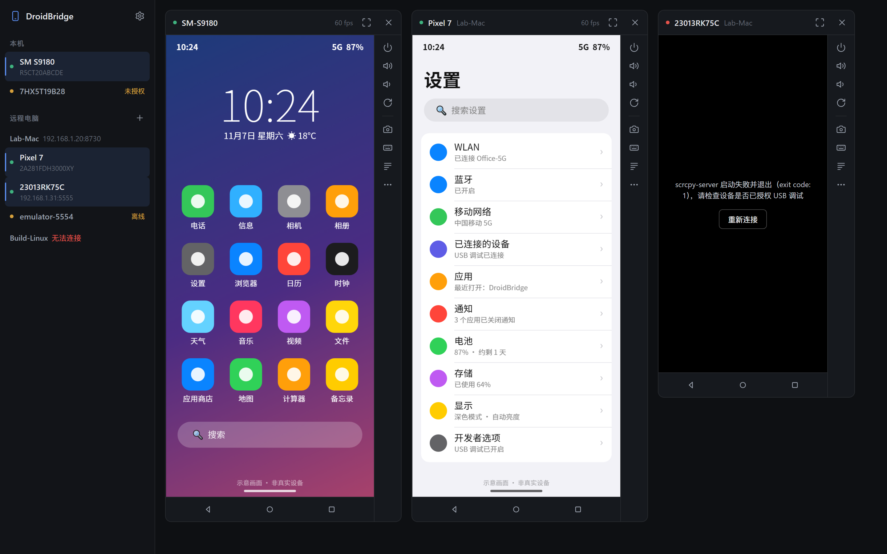
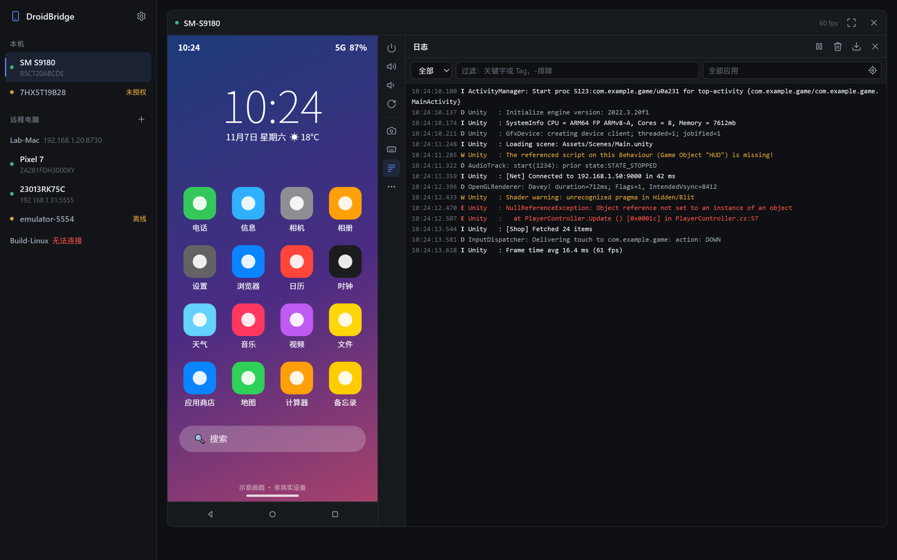
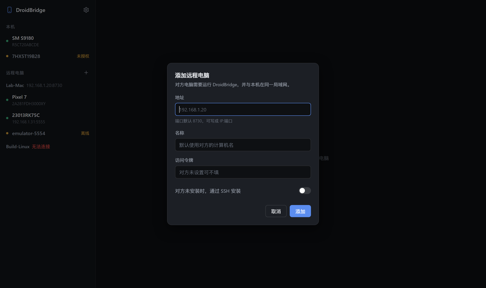
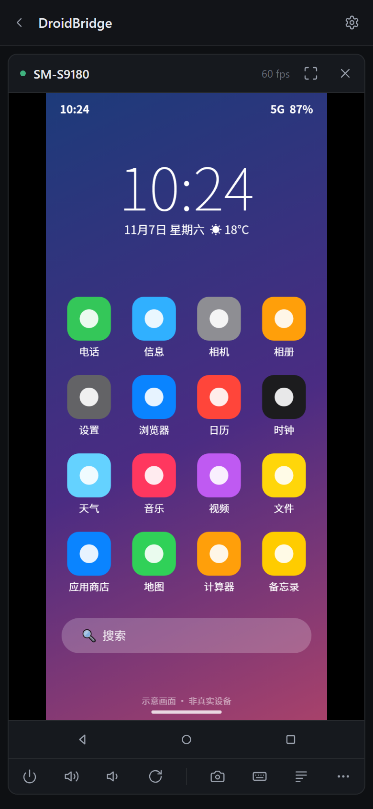

# DroidBridge

在电脑上查看并操作安卓设备的屏幕——不只是插在本机上的，还包括插在局域网里其他电脑上的。



- **投屏与操作**：基于 [scrcpy](https://github.com/Genymobile/scrcpy) 的设备端硬件编码，低延迟；支持点击、多指触控、滚轮、键盘、剪贴板、截图
- **多电脑统一管理**：每台插着手机的电脑运行一个 DroidBridge，在任意一台上添加其他电脑后，统一查看和操作所有设备
- **SSH 一键部署**：添加 macOS / Linux 电脑时可通过 SSH 自动安装并注册为开机服务
- **设备日志**：在画面旁实时查看 logcat，可按级别、关键字、应用过滤
- **安装 APK / 传文件**：把文件拖到设备画面上即可
- **桌面版 + 浏览器访问**：Windows 桌面客户端（WebView2）；手机或其他电脑也可以直接用浏览器打开

| 设备日志 | 添加远程电脑 | 手机浏览器 |
|---|---|---|
|  |  |  |

> 截图使用的是模拟数据，手机画面为示意图（`tools/demo/shots.ps1` 生成）。

## 工作原理

```
 桌面版 / 浏览器
   │  HTTP + WebSocket（只连接当前打开的节点）
   ▼
 DroidBridge 节点 A ──USB/adb──▶ 安卓设备 1、2…
   │  中转设备列表、视频流、日志、文件
   ▼
 DroidBridge 节点 B（局域网另一台电脑） ──USB/adb──▶ 安卓设备 3、4…
```

- 节点通过 `adb` 把 scrcpy-server 推到设备上运行，设备用 MediaCodec 把屏幕编码成 H.264，经 `adb forward` 传回节点，再通过 WebSocket 转给界面，由 WebCodecs 硬件解码。
- 触摸、按键等操作按 scrcpy 控制协议发回设备注入。
- 界面只和自己打开的节点通信，远程电脑上的设备由这个节点中转，因此远程电脑只需开放 HTTP 端口。

## 下载与使用

> 目前提供 Windows 安装包；macOS / Linux 可从源码编译服务版，或在 Windows 桌面版里通过 SSH 自动安装。

安装包中有两个程序：

| 程序 | 用途 |
|---|---|
| `DroidBridge.exe` | **桌面版**，独立窗口（需要 Microsoft Edge WebView2，Win10/11 一般已自带）。同时运行服务，其他电脑可以添加本机 |
| `droidbridge-server.exe` / `start-server.bat` | **服务版**，无界面，适合只插手机的电脑，或用浏览器访问 |

1. 手机打开 **开发者选项 → USB 调试**，连接电脑后在手机上点“允许”。小米等机型还需打开 **USB 调试（安全设置）**，否则无法点击和输入。
2. 运行 `DroidBridge.exe`，在左侧点击设备即可投屏。
3. 添加其他电脑：点“远程电脑”旁的 **+**，填写对方 IP（默认端口 8730）。
   - 对方是 Windows：在对方电脑上运行 DroidBridge 即可。
   - 对方是 macOS / Linux 且未安装：打开“通过 SSH 安装”，会使用本机 `~/.ssh` 中的密钥登录，上传源码在对方编译（需要 Rust，没有时自动用 rustup 安装到当前用户），查找或用 Homebrew 安装 adb，并注册为登录启动服务（launchd / systemd --user）。
4. 首次运行时如果 Windows 防火墙弹窗，请允许“专用网络”，否则其他电脑无法连接本机。

### 操作方式

| 操作 | 效果 |
|---|---|
| 左键点击 / 拖动、手指触摸（多指） | 点击 / 滑动 |
| 右键、Esc | 返回 |
| 中键 | 主页 |
| 滚轮 | 滚动 |
| 聚焦画面后打字 | 输入字符；回车、退格、方向键可用 |
| Ctrl+V | 粘贴本机剪贴板到设备 |
| 右侧图标栏 | 电源、音量、旋转、截图、输入文字（中文等）、日志；“…”里是通知栏、熄屏投屏、安装 APK、重连 |
| 拖文件到画面 | APK 安装，其他文件传到 `/sdcard/Download` |

### 设备日志

点图标栏的 **日志** 打开 logcat 面板。窗口够宽时在画面右侧，否则在下方。

- 级别过滤；关键字过滤（空格分隔为“且”，`-词` 表示排除）
- 填写包名或点 ⊙ 选择当前前台应用，只看该应用的日志（应用重启后仍会跟踪）
- 暂停、清空、保存为文本文件

### 用浏览器访问

浏览器的 WebCodecs 只在安全上下文（`https://` 或 `localhost`）中可用：

- 本机：`http://localhost:8730`
- 其他设备：`https://<电脑IP>:8731`（首次启动时生成的自签名证书，第一次访问需选择“继续访问”）

## 安全须知

DroidBridge 能完全控制连接的设备，默认**不需要认证**，请只在可信的局域网中使用：

- 用 `--token <令牌>` 启用访问令牌（网页、远程节点访问都需要），或 `--bind 127.0.0.1` 只允许本机访问。
- 不要把端口暴露到公网。
- 远程电脑的令牌保存在本机 `data/peers.json` 中（明文）。

## 命令行参数

```
--port <端口>         HTTP 端口（默认 8730）
--https-port <端口>   HTTPS 端口（默认 8731，0 表示关闭）
--bind <地址>         监听地址（默认 0.0.0.0）
--token <令牌>        访问令牌（也可用环境变量 DROIDBRIDGE_TOKEN）
--name <名称>         本机显示名称（默认计算机名）
--adb <路径>          adb 路径（默认依次查找：程序目录 platform-tools、ANDROID_HOME、常见安装位置、PATH）
--data <目录>         数据目录（默认程序目录下 data，存放远程电脑列表、证书、日志）
```

## 从源码编译

需要 Rust 1.85+。

```sh
cargo run                                          # 服务版（任意平台）
cargo run --features desktop --bin droidbridge-desktop   # 桌面版（Windows）
cargo test
```

Windows 打包（会先运行 `tools/fetch-deps.ps1` 下载 platform-tools 并校验 scrcpy-server）：

```powershell
powershell -File build.ps1      # 输出 dist\DroidBridge 与 dist\DroidBridge-win64.zip
```

### 目录结构

```
src/lib.rs          HTTP 服务、路由、令牌校验、远程电脑接口、文件上传
src/main.rs         服务版入口
src/bin/desktop.rs  桌面版（tao + wry / WebView2）
src/adb.rs          adb 调用与设备列表
src/scrcpy.rs       投屏会话：启动 scrcpy-server、转发视频流与控制
src/control.rs      JSON 控制指令 → scrcpy v5 控制协议
src/logcat.rs       logcat 流与应用过滤
src/peers.rs        远程电脑存储与 HTTP / WebSocket 中转
src/remote.rs       通过 SSH 安装到 macOS / Linux
web/index.html      界面（单文件，编译时嵌入）
third_party/        scrcpy-server v5.0.1（见 third_party/README.md）
tools/              依赖下载、截图生成
```

### 接口概览

| 接口 | 说明 |
|---|---|
| `GET /api/info` | 节点信息 |
| `GET /api/devices?peer=` | 设备列表（`peer` 为远程电脑 id，省略为本机） |
| `GET/POST /api/peers`、`PUT/DELETE /api/peers/{id}` | 远程电脑管理 |
| `POST /api/install`、`GET /api/install/{job}` | 通过 SSH 安装到远程电脑 |
| `POST /api/push?serial=&name=&peer=` | 上传文件（APK 安装，其他推送到 Download） |
| `WS /ws/stream?serial=&peer=&max_size=&bit_rate=&max_fps=` | 视频流与控制 |
| `WS /ws/logcat?serial=&peer=` | 日志流 |

`/ws/stream` 的二进制消息格式为 `[flags u8][pts u64 BE][H.264 Annex-B]`（flags bit0 = 配置包，bit1 = 关键帧）；控制消息为 JSON，如 `{"t":"touch","action":0,"id":-2,"x":100,"y":200,"w":720,"h":1600}`，详见 `src/control.rs`。

## 计划

- 局域网自动发现节点
- 无线 adb（配对 / 连接）
- 音频转发、录屏
- 多设备同步操作

## 致谢

- [scrcpy](https://github.com/Genymobile/scrcpy)（Apache-2.0）提供设备端的投屏与控制服务
- [tao](https://github.com/tauri-apps/tao) / [wry](https://github.com/tauri-apps/wry)、[axum](https://github.com/tokio-rs/axum)、[tokio](https://tokio.rs)

## 许可

DroidBridge 以 [MIT](LICENSE) 许可发布。随附的 scrcpy-server 遵循 Apache-2.0，见 [third_party/README.md](third_party/README.md)。
