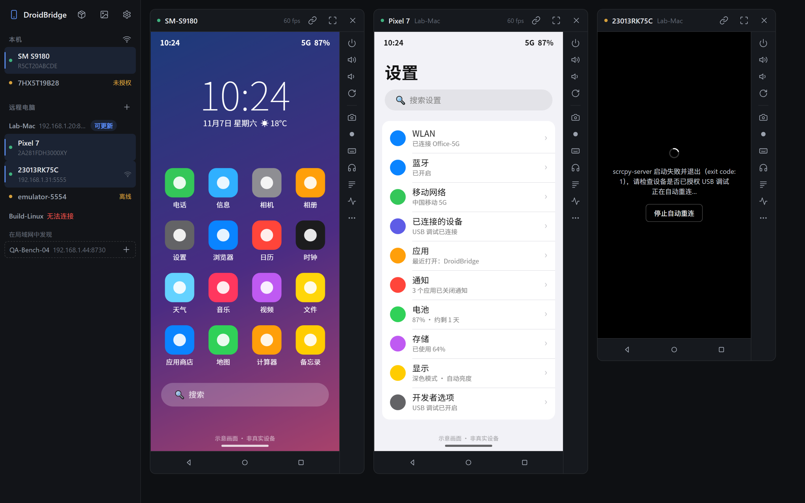
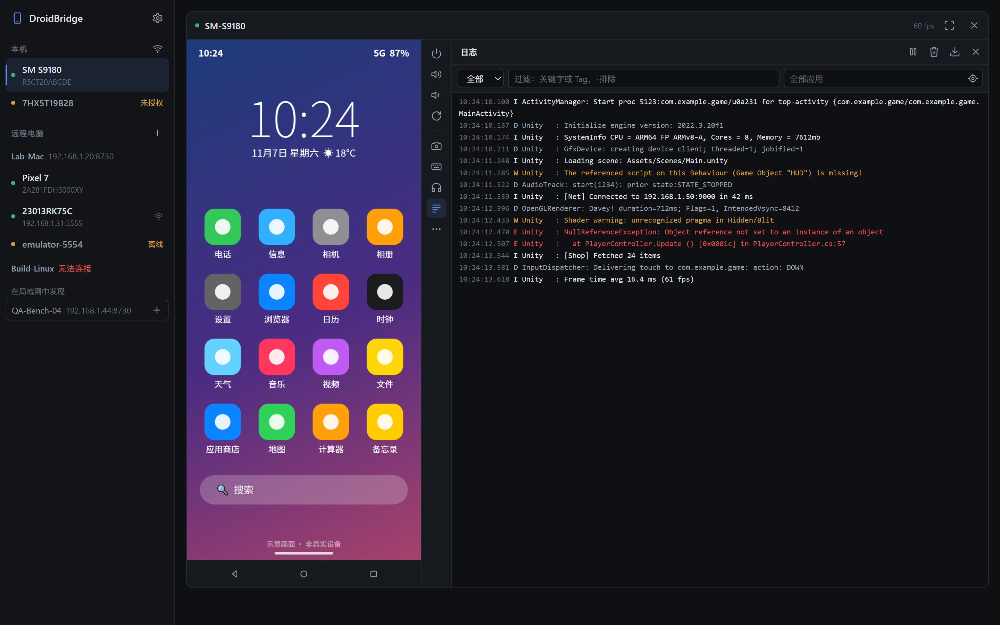
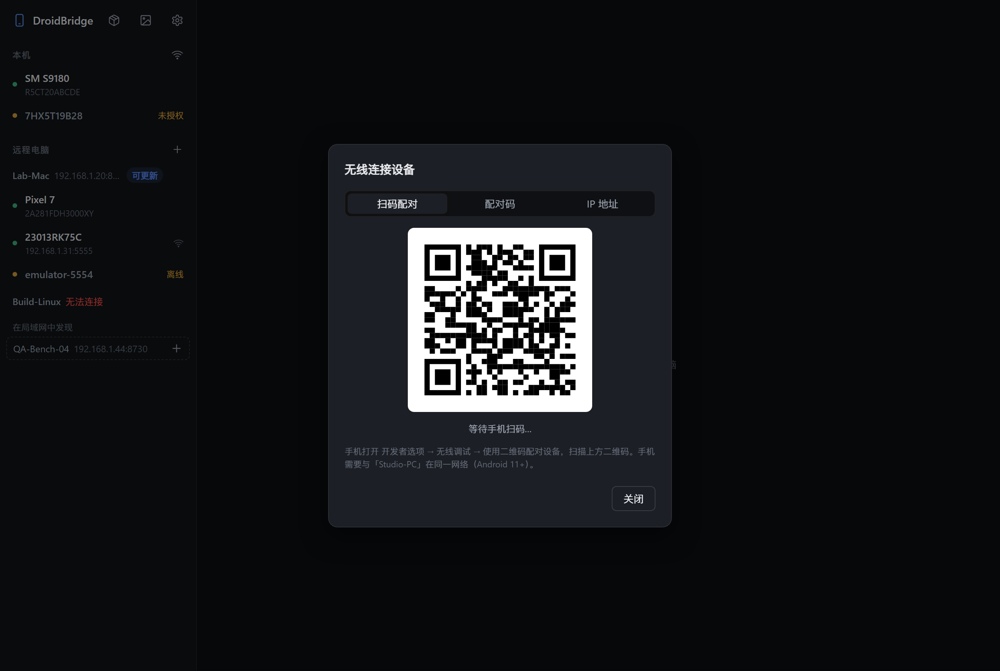
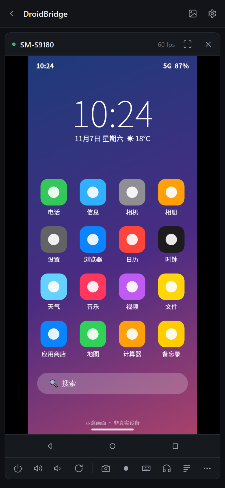
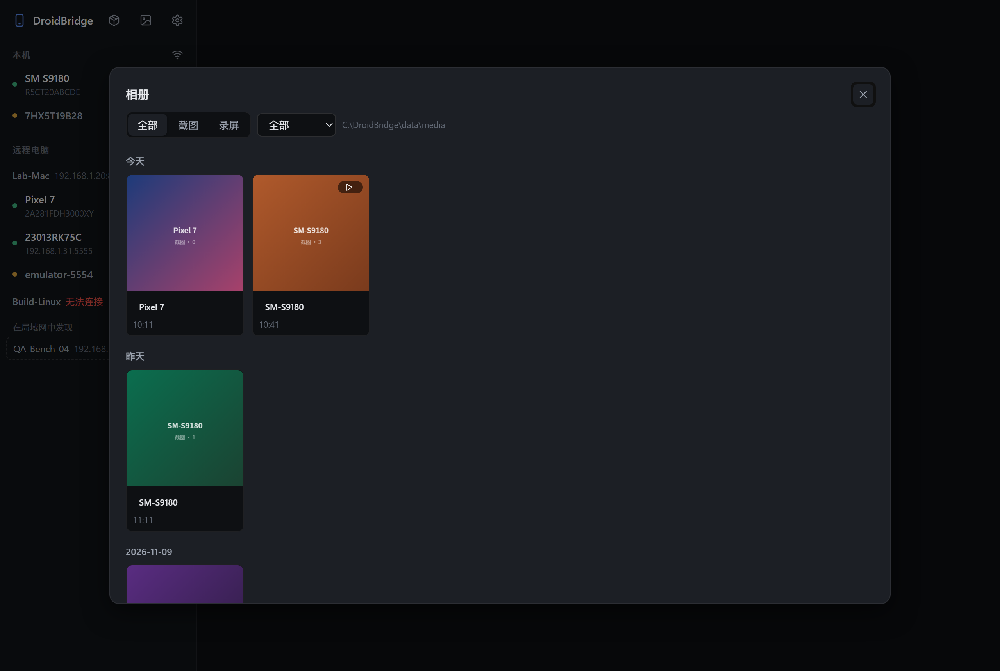
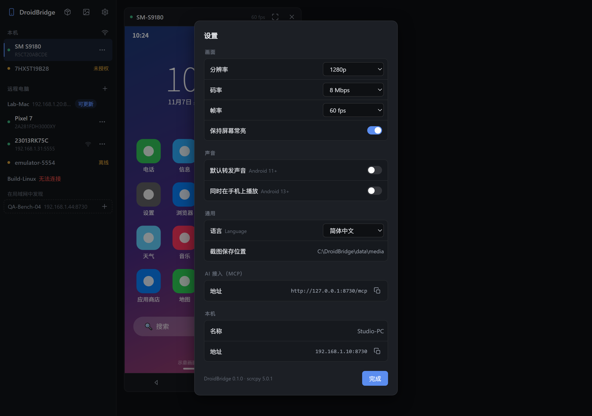
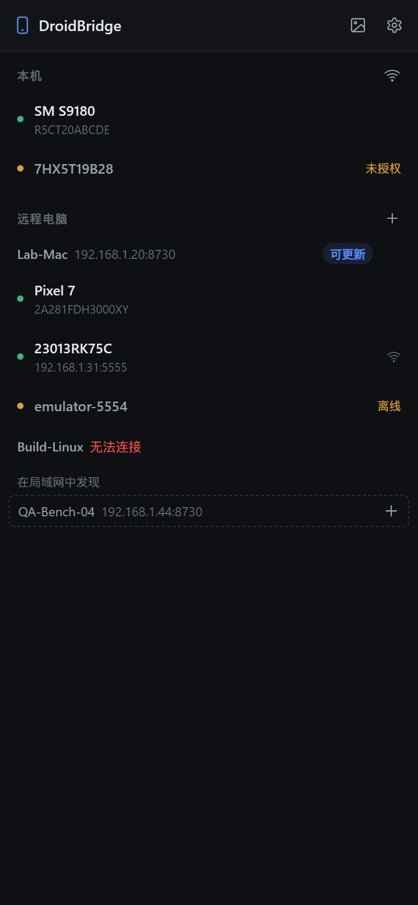
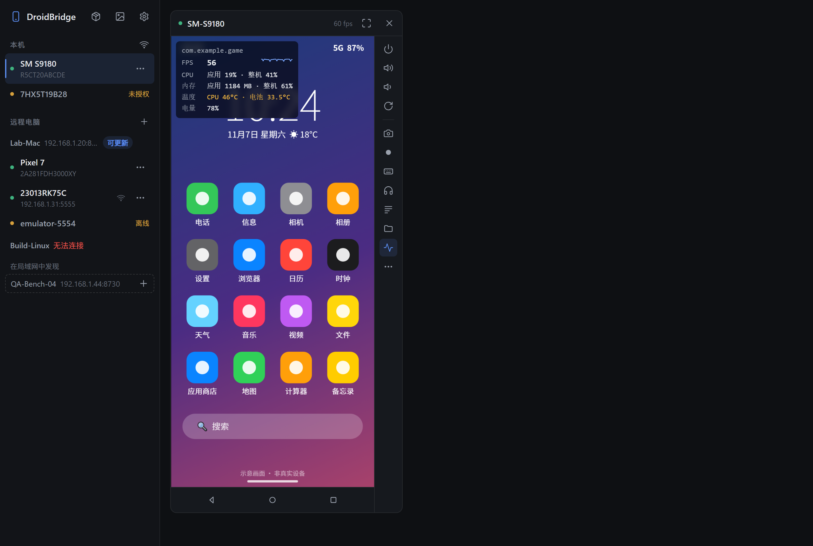
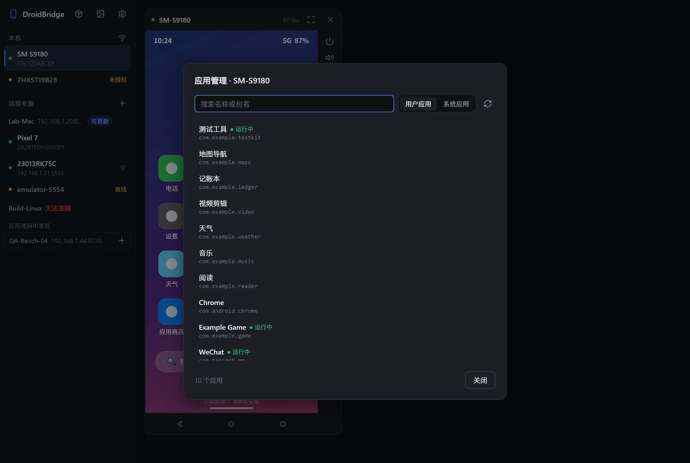
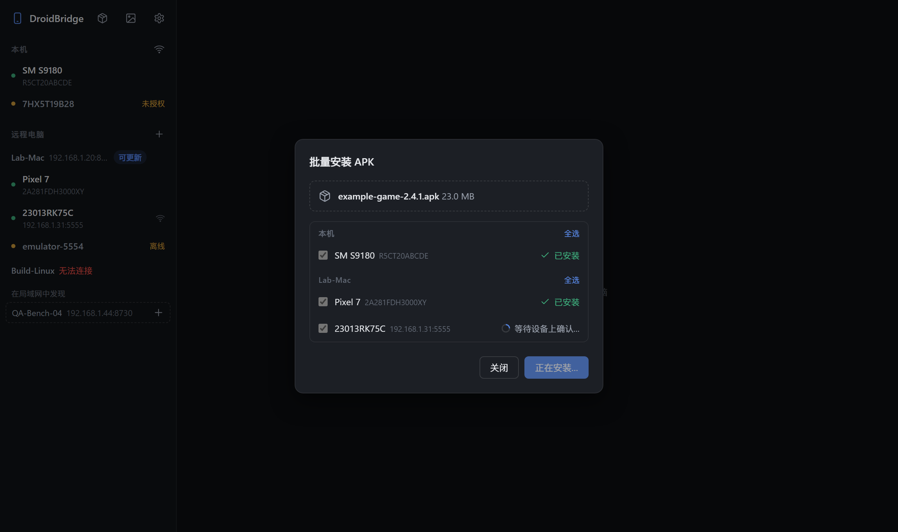

# DroidBridge

[English](README.md)

在电脑上查看并操作安卓设备的屏幕——不只是插在本机上的，还包括插在局域网里其他电脑上的。



- **投屏与操作**：基于 [scrcpy](https://github.com/Genymobile/scrcpy) 的设备端硬件编码，低延迟；支持点击、多指触控、滚轮、键盘、剪贴板、截图、录屏
- **多电脑统一管理**：每台插着手机的电脑运行一个 DroidBridge；同一局域网内的电脑会被自动发现，点一下即可添加
- **无线 adb**：扫码或配对码配对（Android 11+）、按 IP 连接，或把 USB 设备切换为无线
- **断线自动重连**：重新插拔、手机重启或 Wi-Fi 断开后自动恢复投屏；同一台手机另有 USB / 无线连接时会自动切换过去
- **声音转发**：在电脑上听到手机的声音（Android 11+）
- **SSH 一键部署**：添加 macOS / Linux 电脑时可通过 SSH 自动安装并注册为开机服务
- **设备日志**：在画面旁实时查看 logcat，可按级别、关键字、应用过滤
- **性能浮层**：在画面上显示前台应用的帧率、CPU、内存，以及温度和电量
- **应用管理**：列出已安装应用，启动、强制停止、清除数据、卸载
- **批量安装与群控**：一个 APK 一次装到多台设备；在多台设备上同步点击和按键
- **AI Agent（MCP）**：让 Claude Code、Cursor 等支持 MCP 的 AI 工具读取画面并操作任意设备；每次操作都能实时看到，随时可以暂停
- **安装 APK / 传文件**：把文件拖到设备画面上即可
- **相册**：截图与录屏保存在节点上，可在相册中浏览（按类型/设备筛选、预览、下载、在文件管理器中显示）
- **桌面版 + 浏览器访问**：Windows、macOS、Linux 桌面客户端；手机或其他电脑也可以直接用浏览器打开

| 设备日志 | 无线配对 | 手机浏览器 |
|---|---|---|
|  |  |  |
|  |  |  |
|  |  |  |

> 截图使用的是模拟数据，手机画面为示意图（`tools/demo/shots.ps1` 生成）。

## 工作原理

```
 桌面版 / 浏览器
   │  HTTP + WebSocket（只连接当前打开的节点）
   ▼
 DroidBridge 节点 A ──USB/adb──▶ 安卓设备 1、2…
   │  中转设备列表、视频流、日志、文件
   ▼
 DroidBridge 节点 B（局域网另一台电脑） ──USB/adb──▶ 安卓设备 3、4…
```

- 节点通过 `adb` 把 scrcpy-server 推到设备上运行，设备用 MediaCodec 把屏幕编码成 H.264，经 `adb forward` 传回节点，再通过 WebSocket 转给界面，由 WebCodecs 硬件解码。
- 触摸、按键等操作按 scrcpy 控制协议发回设备注入。
- 界面只和自己打开的节点通信，远程电脑上的设备由这个节点中转，因此远程电脑只需开放 HTTP 端口。

## 下载

在 [Releases](https://github.com/dmxzxy/DroidBridge/releases) 下载最新版本，每个安装包都带有 Android platform-tools（adb）。

| 平台 | 桌面版 | 服务版 |
|---|---|---|
| Windows x64 | `DroidBridge-<版本>-windows-x64.zip` → `DroidBridge.exe`（需要 WebView2，Win10/11 一般已自带） | 同一压缩包 → `droidbridge-server.exe` |
| macOS（Apple 芯片与 Intel） | `DroidBridge-<版本>-macos-universal.zip` → `DroidBridge.app` | `droidbridge-server-<版本>-macos-universal.tar.gz` |
| Linux x86_64 | `droidbridge-desktop-<版本>-linux-x86_64.tar.gz`（需要 WebKitGTK 4.1，如 `libwebkit2gtk-4.1-0`） | `droidbridge-server-<版本>-linux-x86_64.tar.gz` |

桌面版同时也在运行服务，其他电脑可以添加它；只插手机、不看画面的电脑用服务版即可。

> **macOS**：应用未经公证。第一次打开时请右键点击选择“打开”，或运行 `xattr -cr DroidBridge.app`。
>
> **Linux**：普通用户使用 USB 设备需要安装发行版的 Android udev 规则（如 `android-sdk-platform-tools-common`）。

## 使用

1. 手机打开 **开发者选项 → USB 调试**，连接电脑后在手机上点“允许”。小米等机型还需打开 **USB 调试（安全设置）**，否则无法点击和输入。
2. 启动 DroidBridge，在左侧点击设备即可投屏。
3. 添加其他电脑：同一局域网内运行 DroidBridge 的电脑会出现在“在局域网中发现”下，点 **+** 即可添加；也可以点“远程电脑”旁的 **+** 手动填写 IP（默认端口 8730）。
   - 对方是 Windows：在对方电脑上运行 DroidBridge 即可。
   - 对方是 macOS / Linux 且未安装：切换到“通过 SSH 安装”，可以用本机 SSH 密钥（`~/.ssh`、ssh-agent、`~/.ssh/config`）、账号密码或指定的密钥文件登录。用密码登录时勾选“记住登录”，会把本机公钥加到对方，以后重新安装不用再输密码；密码本身不会保存。之后安装 GitHub Releases 中同版本的预编译服务端（由对方电脑直接下载；对方访问不了 GitHub 时由本机下载后上传；会校验 SHA-256）。都不行时（或使用开发版时）上传源码在对方编译（需要 Rust，没有时自动用 rustup 安装）。然后使用对方已有的 adb 或安装包附带的 platform-tools，并注册为登录启动服务（launchd / systemd --user），进程退出会自动重启。
4. 如果防火墙弹窗，请允许“专用网络”，否则其他电脑无法连接本机。

### 操作方式

| 操作 | 效果 |
|---|---|
| 左键点击 / 拖动、手指触摸（多指） | 点击 / 滑动 |
| 右键、Esc | 返回 |
| 中键 | 主页 |
| 滚轮 | 滚动 |
| 聚焦画面后打字 | 输入字符；回车、退格、方向键可用 |
| Ctrl+V | 粘贴本机剪贴板到设备 |
| 右侧图标栏 | 电源、音量、旋转、截图、录屏、输入文字（中文等）、日志；“…”里是通知栏、熄屏投屏、安装 APK、重连 |
| 拖文件到画面 | APK 安装，其他文件传到 `/sdcard/Download` |

### 无线连接

点“本机”旁的 Wi-Fi 图标（远程电脑在其 “…” 菜单中选“无线连接设备…”）。手机需要与该电脑在同一网络。

- **扫码配对**（Android 11+）：手机打开 开发者选项 → 无线调试 → 使用二维码配对设备，扫码即可
- **配对码**（Android 11+）：填写手机上显示的配对地址、端口和配对码
- **IP 地址**：已配对过、或执行过 `adb tcpip` 的设备
- USB 设备可在 “…” 菜单选“切换为无线连接”，自动执行 `adb tcpip 5555` 并连接，之后可以拔掉数据线

无线地址会被记住并在后台自动重连；通过 mDNS 公布的已配对设备也会自动重连。

### 声音

点右侧图标栏的耳机图标，或在 **设置 → 声音** 中打开“默认转发声音”。需要 Android 11+（Android 11 开始投屏时需解锁屏幕）。声音使用 Opus 编码，浏览器不支持 Opus 解码时改用原始 PCM。“同时在手机上播放”需要 Android 13+。

### 截图、录屏与相册

点**相机**图标保存当前画面，点**录屏**图标（红点）开始/停止录屏。截图保存为 PNG，录屏保存为 WebM / MP4（开启声音转发时含声音）。文件保存在所连接节点的**媒体目录**（默认 `<data>/media`，可在“设置 → 截图保存位置”中修改，或用 `--media-dir` 指定）。若录屏中途关闭应用或刷新页面，未完成的文件会被自动恢复（超过 2 分钟没有写入的录屏会自动转成可播放的正式文件）。

点侧栏齿轮旁的**相册**图标浏览全部内容：按类型或设备筛选，点缩略图预览（左右键/按钮切换，Esc 关闭），可下载、在文件管理器中显示或删除。

### 设备日志

点图标栏的 **日志** 打开 logcat 面板。窗口够宽时在画面右侧，否则在下方。

- 级别过滤；关键字过滤（空格分隔为“且”，`-词` 表示排除）
- 填写包名或点 ⊙ 选择当前前台应用，只看该应用的日志（应用重启后仍会跟踪）
- 暂停、清空、保存为文本文件

### 性能浮层

点图标栏的 **性能数据**（脉搏图标），画面左上角会显示性能浮层，每秒刷新：

- **帧率**：前台应用的帧率，用 SurfaceFlinger 的帧时间统计（游戏、SurfaceView 也能统计；取不到时用 `dumpsys gfxinfo`），并显示最近的走势
- **CPU**：应用和整机的 CPU 占用（`/proc/stat`、`/proc/<pid>/stat`）
- **内存**：应用的 PSS（`dumpsys meminfo`）和整机内存占用
- **温度**（CPU 取自 `dumpsys thermalservice`，以及电池温度）和**电量**

每秒执行一次简短的 adb 命令，不需要时请关掉浮层。

### 应用管理

**更多（⋯）→ 应用管理…** 列出已安装的应用，显示应用名称（由 scrcpy-server 在设备上读取），分为用户应用和系统应用，可以搜索，正在运行的会标出。可以直接启动应用，⋯ 里有强制停止、清除数据和卸载（后两项需确认）。

有些系统不允许通过 adb 清除数据：OPPO / 一加 / realme 需在开发者选项中打开“禁止权限监控”；小米需打开“USB 调试（安全设置）”。

### 批量安装与群控

- **批量安装**：点侧边栏顶部的安装包图标（或把 APK 拖到窗口空白处），勾选本机和远程电脑上的设备后安装。最多同时装 4 台，每台显示安装结果，失败的可以重试。OPPO、vivo、小米等手机会在设备上弹出确认，此时会显示“等待设备上确认…”。
- **群控**：打开两台及以上设备后，在设备标题栏点链接图标加入群控。在任一台群控设备上的点击、滑动、滚轮、按键和输入的文字，都会同步到所有群控设备；坐标按各设备分辨率等比换算，宽高比相同的设备对得最准。

### 用浏览器访问

浏览器的 WebCodecs 只在安全上下文（`https://` 或 `localhost`）中可用：

- 本机：`http://localhost:8730`
- 其他设备：`https://<电脑IP>:8731`（首次启动时生成的自签名证书，第一次访问需选择“继续访问”）

### 更新远程电脑

远程电脑运行的版本比本机旧时，电脑名旁会显示 **可更新**。用密钥（或勾选了“记住登录”的密码）通过 SSH 安装的电脑，点一下即可装上本机的版本并重启服务；否则会打开重新安装窗口。Windows 电脑需要在对方电脑上更新。

全部更新的做法：先把自己电脑上的 DroidBridge 更新到新版本，再逐个点远程电脑的 **可更新**。

无法访问 GitHub 的内网：把发布文件（`droidbridge-server-*.tar.gz` 和 `SHA256SUMS.txt`）放到内网网页服务器上，并用环境变量 `DROIDBRIDGE_RELEASE_BASE=http://服务器/路径` 启动 DroidBridge。

### AI Agent（MCP）

DroidBridge 同时是一个 [MCP](https://modelcontextprotocol.io) 服务，地址 `http://127.0.0.1:8730/mcp`（Streamable HTTP，设置页里也能看到）。支持 MCP 的 AI 工具接入后，就能查看并操作本机和所有远程电脑上的设备。

```bash
# Claude Code
claude mcp add --transport http droidbridge http://127.0.0.1:8730/mcp
```

```json
// Cursor 等使用 mcpServers 配置文件的工具
{ "mcpServers": { "droidbridge": { "url": "http://127.0.0.1:8730/mcp" } } }
```

启用了 `--token` 时，用请求头 `Authorization: Bearer <令牌>` 传入（或在地址后加 `?token=<令牌>`）。

工具：`list_devices`、`read_screen`（界面元素的文字、id 和坐标，省 token 且准确）、`screenshot`、`tap`（按元素编号或坐标）、`swipe`、`type_text`（支持中文）、`press_key`、`list_apps`、`launch_app`、`stop_app`、`logcat`、`perf`、`shell`（只允许只读查询）、`wait`。

AI 操作设备时，投屏窗口底部会显示当前操作，每次点击和滑动的位置都会标出来。点 **暂停** 后 AI 不能再改变设备（仍可读取画面），点 **继续** 恢复。

说明：
- `read_screen` 基于 `uiautomator`，读不到游戏、一直在变化的画面和安全界面；平板分屏显示的应用可能只读到当前焦点的一侧。这些情况 AI 会改用 `screenshot`。
- `type_text` 通过设备剪贴板粘贴，输入的文字会留在剪贴板里。
- 能访问这个端口的人都能使用这些工具，见[安全须知](#安全须知)。

### 语言

界面跟随系统语言（中文或英文）。可在 **设置 → 语言** 中切换，或启动时加 `--lang zh` / `--lang en`。

## 安全须知

DroidBridge 能完全控制连接的设备，默认**不需要认证**，请只在可信的局域网中使用：

- 用 `--token <令牌>` 启用访问令牌（网页、远程节点访问都需要），或 `--bind 127.0.0.1` 只允许本机访问。
- 不要把端口暴露到公网。
- MCP 接口（`/mcp`）可以让 AI 操作设备，使用同一个访问令牌。
- 局域网自动发现会在 UDP 8730 上广播本机名称和 HTTP 端口；可用 `--no-discovery` 关闭（`--bind 127.0.0.1` 时也会关闭）。
- 远程电脑的令牌以明文保存在数据目录的 `peers.json` 中。

## 命令行参数

```
--port <端口>         HTTP 端口（默认 8730）
--https-port <端口>   HTTPS 端口（默认 8731，0 表示关闭）
--bind <地址>         监听地址（默认 0.0.0.0）
--token <令牌>        访问令牌（也可用环境变量 DROIDBRIDGE_TOKEN）
--name <名称>         本机显示名称（默认计算机名）
--adb <路径>          adb 路径（默认依次查找：随附的 platform-tools、ANDROID_HOME、常见安装位置、PATH）
--data <目录>         数据目录（见下）
--media-dir <目录>    截图与录屏保存目录（默认 <data>/media）
--lang <zh|en>        界面与提示语言（默认跟随系统，也可用 DROIDBRIDGE_LANG）
--no-discovery        不参与局域网自动发现
```

默认数据目录（远程电脑列表、无线设备地址、证书、日志）：Windows 为程序目录下的 `data\`，macOS 为 `~/Library/Application Support/DroidBridge`，Linux 为 `~/.local/share/droidbridge`。

## 从源码编译

需要 Rust 1.85+。Linux 编译桌面版还需要 `libwebkit2gtk-4.1-dev`、`libgtk-3-dev`。

```sh
cargo run                                               # 服务版
cargo run --features desktop --bin droidbridge-desktop  # 桌面版
cargo test
```

打包：

```sh
powershell -File build.ps1 -Version 0.2.0   # Windows（会下载 platform-tools）
sh tools/package-mac.sh 0.2.0               # macOS
sh tools/package-linux.sh 0.2.0             # Linux
```

发布由 GitHub Actions 完成：推送 `v*` 标签后自动构建各平台安装包，并创建 Release 草稿。

前端代码按功能拆分在 `web/app.css` 和 `web/js/`（多语言、基础工具、菜单与对话框、后端调用、设备列表、远程电脑与设置、投屏查看器、日志、声音、相册），经典脚本按顺序加载、共享全局作用域。

目录结构、接口说明见 [英文 README](README.md#layout)。

## 计划

- 崩溃 / ANR 捕获
- AI：把操作录成可重复执行的脚本、等待元素出现、多设备并行执行
- 性能数据记录与导出
- iOS 设备（基于 WebDriverAgent）

## 致谢

- [scrcpy](https://github.com/Genymobile/scrcpy)（Apache-2.0）提供设备端的投屏与控制服务
- [tao](https://github.com/tauri-apps/tao) / [wry](https://github.com/tauri-apps/wry)、[axum](https://github.com/tokio-rs/axum)、[tokio](https://tokio.rs)

## 许可

DroidBridge 以 [MIT](LICENSE) 许可发布。随附的 scrcpy-server 遵循 Apache-2.0，见 [third_party/README.md](third_party/README.md)。
